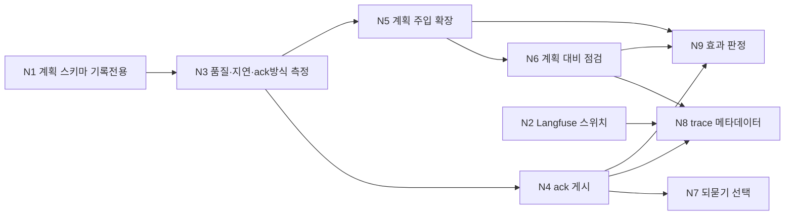

# 입출력 절차 적용 계획 (2026-11-19)

사용자의 에이전트 입출력 절차를 slack-cli-agent 요청 처리에 적용하는 계획.
목표 모델은 sonnet, Langfuse 는 선택. 구현 전 상태이며 이 문서가 작업 의존
그래프의 단일 출처다. 레퍼런스는
`/Users/taelkim/Jobs/tasks/2026-11-19-에이전트-입출력-사고절차-레퍼런스.md`.
11-19 advisor 검토를 반영했다. 인용한 줄은 메인 세션이 직접 확인했다.

## 적용할 절차

1. 해석·분류
1. 인풋 채우기, 기대 아웃풋을 사용자에게 바로 응답 후 이어서 작업
1. 조사·계획·검증법 (검증법은 계획의 일부)
1. 병렬 작업 (의존성 그래프)
1. 셀프 피드백: 초기 계획·검증 기준 대비 점검. 만족도 재평가가 아님
1. 전달

## 현재 구조와의 대응

- 이미 있는 것
    - 해석·분류: `guard/plan_start.py` 계획 호출(haiku, 도구 없음, JSON
      schema). `type`(short/branch/explore) + `workflow` 의미 분류(기록 전용)
    - 의존성 그래프: 계획 `branches[].depends_on`, `delegate`.
      `guard/pretool/plan_gate.py` 가 첫 도구 호출 때 `[작업 순서]` 로 주입
    - 병렬 실행: 주입문의 "의존 없는 갈래는 함께 부른다", 작업자 위임
        - 11-16 측정: 위임은 계획 대기 약 10초 + 작업자 기동 비용으로 일반
          질문에서 손해. `SCA_PLAN_SYNC`, `SCA_PLAN_FORCE_PARALLEL` 운영 꺼짐
    - 완료 점검: `guard/finish_review.py` Stop 훅 verify(sonnet)
        - 답변 문장이 도구 결과에 근거하는지만 봄
        - 400자 이상 + 주장 표지가 있을 때만 호출(`finish_review.py:845-849`)
    - 계획 결과 audit 기록: `core/pipeline.py` `_plan_fields`
        - workflow 후보가 없으면 통째로 빠짐(`pipeline.py:2060`)
    - 계획 파일 경로: 봇이 `--session-id` 로 세션 id 를 정하므로 실행 중
      계산 가능. 읽는 쪽 `core/application.py:2467`
        - 단 `profile.work_root` 고정이라 채널 `workdir` 를 쓰는 봇에선 어긋남
- 없는 것
    - 인풋 채우기: 가정한 인풋·빠진 인풋·되물을 질문 필드 없음
    - 기대 아웃풋 즉시 응답: 진행 표시는 응답 끝에 지워지는 표시
    - 검증법: 계획에 확인 기준 필드 없음. verify 는 계획을 안 읽음
    - short 계획은 주입 안 함(`plan_gate.py:189`)
    - Langfuse: 코드에 없음. 신지만 운영물 `~/.shinji/engine/settings-claude.json`
      에 Stop·SessionEnd 훅을 넣어 둠. 이 파일은 `load_merged_settings` →
      `--settings` 로 이미 들어감(`engine/claude.py:763-776`)

## 실측 (11-19, 신지 계획 파일 330개)

- status ok 283: short 230(81%), branch 44, explore 9. error:cli 47
- 계획 지연 p50: short 3.1초, branch 8.0초, explore 6.5초 (advisor 측정)
- 계획 완료 → 턴 종료 근사 p50: short 7.6초, branch 30.2초 (advisor 측정,
  transcript mtime 기준)
- type 판정 대 실제 도구 호출 수 (메인 세션 측정, transcript 남은 133건,
  마지막 사용자 요청 이후 메인 transcript 의 tool_use 수, 서브에이전트 호출 제외)
    - short 98건: 중앙값 1, 2회 이하 73건(75%), 5회 이상 7건, 최대 31
    - branch 28건: 중앙값 3, 2회 이하 9건, 5회 이상 8건, 최대 63
    - explore 7건: 중앙값 4
    - 한계: 호출 수는 필요량이 아니라 실제 행동. branch 만 계획 주입을 받아
      호출 수가 주입 영향을 받음. 150건은 transcript 삭제로 대조 불가

## 설계 원칙

- 모든 새 동작은 스위치로 켜고 기본값은 꺼짐
    - 다른 머신의 봇은 설정을 안 바꾸면 지금과 같은 동작
    - 꺼짐 상태에서 조립 지침 sha256 불변, settings 조각 불변을 시험으로 고정
- 기록의 단일 출처는 audit.jsonl. Langfuse 는 선택 출력
- 동작 변경은 한 번에 하나씩 배포하고 replay 로 판정 후 다음 단계
- 목표 모델 sonnet
    - 본 응답: 신지·테스트 채널은 이미 sonnet
    - 계획 호출: 현재 haiku. N3 측정으로 haiku 유지 또는 sonnet 결정
- short 가 81% 라 short 를 빼면 절차가 대부분 턴에 적용 안 됨
    - ack·주입·점검 모두 short 포함을 기본으로 하고, 소음 여부는 N9 에서 판정
- 계획 호출의 예측값(`type`, `ask`, `checks`)은 추정이다 (11-19 사용자 의구심)
    - 기능을 켜고 끄는 기준은 가능하면 관찰값(경과 시간, 실제 도구 호출)으로 둠
    - 예측값을 쓰는 곳은 N3·N9 에서 실제 행동과 대조한 수치를 함께 기록

## 작업 노드

### N1 계획 스키마에 인풋·기대 결과·확인 기준 추가 (기록 전용)

- 추가 필드
    - `intent`: 요청 해석 한 문장
    - `assumed`: 추정으로 채운 인풋 목록
    - `missing`: 추정 불가한 인풋 목록
    - `ask`: 되물을 질문. 없으면 빈 문자열
    - `expected_output`: 사용자가 받을 결과의 형태와 대상
    - `ack`: 사용자에게 바로 보낼 한두 문장. "X 기준으로 Y 를 확인해볼게요"
    - `checks`: 확인 기준 목록. 항목마다 `what`(충족 조건), `how`(도구·원천)
- 스위치: `RuntimeSettings.plan_intake` (기본 false) → `SCA_PLAN_INTAKE`
    - `engine/environment.py` 통과 목록에 추가해야 훅에 닿음
- 검증: `check_workflow`(`plan_start.py:444`) 처럼 형식이 틀리면 새 필드만
  버리고 status 는 `ok` 유지. 새 필드 결함이 기존 계획 주입을 막지 않게
- `plan_gate` 는 새 필드를 안 읽음(`plan_gate.py:134-154`) → 모델 입력 불변
- audit: `_plan_fields` 의 workflow 후보 조건과 분리해 `plan_intake` 켜짐이면
  기록
- 파일: `guard/plan_start.py`, `config/settings.py`, `engine/environment.py`,
  `core/pipeline.py`
- 동작 변경: 없음 (계획 호출 출력이 길어져 계획 도착이 늦어질 수 있음, N3 측정)

### N2 Langfuse 모드 스위치

- 설정 키: `RuntimeSettings.langfuse_hook` (훅 실행 파일 경로, 기본 빈 값 = 꺼짐)
    - 비어 있으면 아무것도 안 붙임
    - 값이 있으면 `_settings_value` 끝(`engine/claude.py:776`)에서 Stop·
      SessionEnd 훅 조각을 merge
    - 값이 있는데 파일이 없으면 기동 시 audit 경보 1회, 훅은 안 붙임
- 전달 경로는 지금과 같은 `--settings` 라 동작 차이 없음
- 훅 본체와 키 파일은 운영물로 유지 (`docs/패키징-경계.md`)
- 신지 이전 순서
    - 설정 키 켬 → 같은 질문 1건으로 trace 적재 확인 → 운영 settings 파일에서
      훅 항목만 제거. 파일 자체는 지우지 않음(삭제 시 `ConfigError`,
      `claude_settings.py:104-110`)
    - 이전 사이 훅이 두 번 붙는 구간: trace 중복 여부 확인 후 제거 시점 결정
- 미확인: `-p` 에서 SessionEnd 훅 발동 여부. 훅 로그에 이벤트 이름이 없음
- 시험: 꺼짐 시 settings 조각에 Langfuse 훅 0건, 켜짐+파일 있음 2건,
  켜짐+파일 없음 0건과 경보
- 동작 변경: 없음

### N3 계획 품질·지연 측정, 계획 모델·ack 방식 결정

- 입력: 과거 요청 30건 (`~/Jobs/tasks/shinji-workflow/router-backfill/labels-30.md`
  표본 재사용), short·branch·explore·재개 턴 포함
- 조건 (각 3회)
    - A: haiku 계획 + N1 필드
    - B: sonnet 계획 + N1 필드
    - C: 계획 필드 대신 본 모델(sonnet)이 첫 텍스트로 ack 를 쓰게 하는 지침
        - transcript tail 로 첫 텍스트를 꺼내는 방식. 엔진이
          `--output-format json` 이라 stdout 으로는 종료 전 텍스트가 안 옴
        - 계획 호출 대기(3-8초)가 없어지는 대신 지침이 바뀜
        - 11-10 기록에 "첫 도구 호출과 함께 텍스트를 안 씀 15/15"
          (`plan_start.py:5-9`). 지금 모델로 재확인
- 측정
    - ack 도착 시각 p50·p90 (요청 수신 기준)
    - 사람 라벨: ack 가 요청 의도와 맞는가, checks 가 확인 가능한 조건인가,
      ask 가 비어야 할 요청에서 비었는가
- 판정 기준(측정 전 고정): ack 일치율 80% 이상인 조건 중 ack 도착이 빠른 쪽.
  모두 미달이면 프롬프트 수정 후 재측정
- 동작 변경: 없음

### N4 기대 아웃풋 즉시 응답 (ack 게시)

- 위치: `ProgressSession` 재사용 안 함 (진행 표시 꺼진 채널에선 안 생기고,
  닫을 때 표시를 지움). `pipeline.py:738` 의 `with` 옆에 별도 context manager
- 동작
    - 엔진 실행 중 계획 파일을 주기적으로 읽음
    - `status: ok` + `ack` 있음 + 요청 수신 후 T초가 지나도 답이 안 끝남
      → 스레드에 1회 게시 (`self._publisher.post`)
        - 11-19 결정: 게시 여부를 계획 `type` 예측으로 정하지 않고 경과 시간
          관찰로 정함. type 은 요청 글만 보고 한 추정이라 short 의 25% 가
          도구 3회 이상 호출(실측 절). 사용자 지시 "의구심을 가지면서 진행"
        - T 는 N3 측정으로 정함. 정하기 전 기본값은 short 턴 종료 p50 근처
    - 최종 응답이 먼저 끝나면 게시 안 함. 게시 직전에 정지 플래그 재확인
- 중복 방지
    - 재시도·가드 재실행이 `UserPromptSubmit` 을 다시 발동시켜 계획 파일을
      새로 만듦(`plan_start.py:369-377`)
    - 게시 여부는 요청 단위(`request_id`) 플래그로 1회만
    - 이전 턴 파일 오인은 계획 파일 시각을 요청 시작 시각과 대조
      (`pipeline.py:2070` 방식)
- 계획 파일 경로는 실제 실행 cwd 기준으로 계산 (`application.py:2490` 의
  `work_root` 고정 수정 포함)
- 계획이 없는 턴(`flow_applies` 거짓 등)은 조용히 건너뜀
- 스위치: `RuntimeSettings.intake_ack` (기본 false)
- audit: `ack_posted`, `ack_latency_sec`, 미게시 사유
- 동작 변경: 있음 (메시지 1건 추가)
- N3 에서 조건 C 가 채택되면 계획 파일 대신 transcript 첫 텍스트를 읽도록 바뀜

### N5 계획 주입에 기대 결과·가정·확인 기준 포함

- `plan_gate.render` 가 `expected_output`, `assumed`, `checks` 를 넣음
- short 계획도 checks 가 있으면 짧은 형태로 주입
    - 근거: N6 이 short 에도 점검하는데 본 모델이 기준을 모르면 차단만 받음
- 스위치: `plan_intake_inject` (기본 false)
- 동작 변경: 있음
- 판정: replay 고정 질문 20개 × 3회, 도구 호출 수·p50·unsupported_claim

### N6 셀프 피드백: 계획 대비 점검

- Stop 훅 입력의 `transcript_path` 로 계획 파일을 읽음(`finish_hook.py:216`)
- checks 항목별 판정: 충족 / 미충족 / 확인 불가. 근거는 이번 턴 도구 결과
  (`pick_evidence`)
    - 미충족 → 1회 차단, 미충족 기준을 전달
    - 확인 불가 → 차단 안 함, 답변에 미확인 표시 요구
- 별도 중첩 호출로 둠
    - 기존 verify 는 400자 미만이면 안 돌아 short 가 점검 밖이 됨
    - `ClaimVerifier` 는 문장 목록만 반환(`finish_review.py:857`) → 인터페이스가 다름
    - checks 가 있는 턴에만 호출. 호출 1회 증가 비용은 N9 에서 측정
- 차단 상한: verify 와 별도 상한. 소유자 턴 verify 상한 1을 공유하면
  차단 후 재점검이 없어 "차단 후 충족" 을 못 잼(`pipeline.py:1307-1314`)
- 반복 차단 필터는 checks 항목 키로 별도 관리
- 판정 결과를 `<transcript>.plan.checks.json` 으로 기록 → audit·N8 입력
- 스위치: `plan_intake_check` (기본 false)
- 동작 변경: 있음
- 판정: 미충족 차단 비율, 차단 후 충족 비율, 응답 시간 증가분

### N7 되묻기 경로 (선택)

- `ask` 가 있고 요청이 쓰기·게시·삭제를 포함하면 작업 전에 질문만 게시하고 턴 종료
    - 계획을 첫 응답 전에 받는 `SCA_PLAN_SYNC` 경로에서만 가능
    - `SCA_PLAN_SYNC` 가 `environment.py` 통과 목록에 없음 → 켜는 경로부터 작업
    - 읽기 요청은 되묻지 않고 `assumed` 로 진행. ack 에 가정이 드러남
- N4 운영 결과에서 사용자 정정이 가정 오류로 나온 비율을 보고 착수 여부 결정

### N8 Langfuse trace 에 계획·점검 메타데이터

- 훅이 `<transcript>.plan.json`, `.plan.checks.json`, ack 기록을 읽어 태그로 추가
    - `workflow`, `type`, `ack_posted`, checks 판정
- ack 기록은 봇 프로세스만 알므로 N4 가 `<transcript>.plan.ack.json` 에 기록
- 같은 Stop 이벤트에서 Langfuse 훅이 finish_hook 보다 먼저 돌면 점검 결과를
  못 봄 → SessionEnd 또는 다음 턴에서 보강. N2 의 SessionEnd 발동 확인 결과에 따름
- 훅은 운영물. 키 이름만 이 문서에 고정

### N9 효과 판정

- N4, N5, N6 배포마다 각각 수행. 기록은 `~/Jobs/tasks/` 결과 문서 + bd

## 의존성 그래프

- 병렬 착수: N1 과 N2
- N4 와 N5 는 코드상 독립이라 병렬 개발 가능. 배포만 순차
- 배포 순서: N1·N2 (동작 불변) → N4 → N5 → N6. 각각 N9 판정 후 다음

## 다른 머신 안전 조건

- 새 키가 없는 설정 = 전부 꺼짐 = 현재 동작
- Langfuse 꺼짐이면 훅 명령 문자열이 settings 에 없음 → 서버 유무 무관
- 시험으로 고정할 것
    - 기본 설정에서 조립 지침 sha256 불변
    - 기본 설정에서 settings 조각 불변
    - 계획 파일에 새 필드가 없거나 깨져도 ack·점검 경로가 예외 없이 건너뜀

## 미결정

- 계획 모델 haiku / sonnet, ack 를 계획 필드로 할지 본 모델 첫 텍스트로 할지: N3
- 되묻기 경로 착수: N4 운영 결과
- 미확인 전제: `-p` SessionEnd 발동, 대체 엔진 턴의 계획 파일 유무
